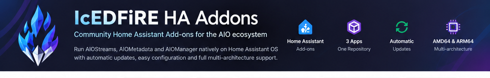

<div align="center">



# IcEDFiRE HA Addons

**Community-maintained Home Assistant apps for the AIO ecosystem.**  
Run AIOStreams, AIOMetadata, and AIOManager on Home Assistant OS with Supervisor management, app configuration, persistent storage, and optional automatic updates.

[](https://www.home-assistant.io/)

[](https://github.com/The-IcEDFiRE/icedfire-ha-addons/actions/workflows/publish.yml)

**[Installation](#installation) · [Available apps](#available-apps) · [Updates](#how-updates-work) · [Backups](#backups-and-data) · [Migration](MIGRATION.md)**

</div>

> [!IMPORTANT]
> **Community project, not an official release by the upstream maintainers or Home Assistant.** Container builds and migration procedures should be tested on your installation before enabling unattended updates. This repository is not affiliated with the upstream projects.

## Available apps

| App | What it does | Upstream project | HAOS host port |
| --- | --- | --- | --- |
|  **[AIOStreams](aiostreams/README.md)** | Stremio streaming add-on and configuration dashboard | [Viren070/AIOStreams](https://github.com/Viren070/AIOStreams) | `3000` |
|  **[AIOMetadata](aiometadata/README.md)** | Metadata service for the AIO ecosystem | [AIOMetadata](https://github.com/cedya77/aiometadata) | `3232` |
|  **[AIOManager](aiomanager/README.md)** | Manage AIO services from a web interface | [AIOManager](https://github.com/Sonicx161/AIOManager) | `1610` |

All three are independently installable. Images target **AMD64 (x86-64)** and **AArch64 (ARM64)**. Some features require credentials or external services; see each app's README before installation.

## Installation

1. **Wait for a successful publish.** The initial app version `0.0.0` is a placeholder. On a new repository, open [GitHub Actions](https://github.com/The-IcEDFiRE/icedfire-ha-addons/actions/workflows/publish.yml) and run **Check upstream images and publish apps**. Verify that both architectures were published and the workflow committed real versions.
2. **Make the GHCR packages public.** Check the visibility of `ha-aiostreams`, `ha-aiometadata` and `ha-aiomanager` in your GitHub packages settings. HAOS needs unauthenticated image pull access.
3. **Add the repository in Home Assistant.** Go to **Settings → Apps → App store → ⋮ → Repositories**, then add:

   ```text
   https://github.com/The-IcEDFiRE/icedfire-ha-addons
   ```

4. **Install the app(s) you want.** Each app appears individually in the app store. Supply required credentials through the app's **Configuration** tab before starting.
5. **Confirm startup and backup.** Check logs, open the web UI, restart, and confirm persistent data survives. Make a Home Assistant backup before enabling auto-updates.

> [!NOTE]
> Menu labels can vary slightly with Home Assistant releases. **Home Assistant OS with Supervisor** is required; this is not an HACS integration or a Docker Compose stack.

## How updates work

```text
Upstream container image digest changes
        ↓
GitHub Actions checks approximately every 6 hours
        ↓
Build/publish AMD64 + ARM64 wrapper image to GHCR
        ↓
Commit new version in this repository
        ↓
Home Assistant discovers the available app update
        ↓
HAOS installs it if you enable that app's Automatic updates toggle
```

Each app's image digest and version are tracked separately. GitHub-hosted scheduled workflows can be delayed. New `latest` tags **do not update running containers by themselves**. Updates are only delivered after a successful publish and Home Assistant's subsequent update check.

**Before using unattended updates:** Validate an initial build, a manual upgrade and a successful recovery from a backup. An upstream release can change required environment variables or database schema.

## Configuration and security

The Home Assistant Configuration tab exposes common bootstrap settings. Additional environment variables can be supplied using `environment_overrides_json`, for example:

```json
{
  "LOG_LEVEL": "debug"
}
```

Use upstream documentation to confirm exact variable names and supported values. Adding runtime variables may override and lock their corresponding dashboard settings. Never commit passwords, tokens, API keys, `SECRET_KEY`, or live `options.json` files to GitHub. Advanced JSON settings are **not password masked**; treat Home Assistant admin access and backup files as sensitive.

## Backups and data

Each app declares `backup: cold` and uses Supervisor-managed persistent storage. Cold backups stop the app during capture to reduce the risk of an inconsistent SQLite snapshot. Confirm that your configured Home Assistant backup includes the apps and their data, and periodically test restores.

| App | Internal persistent-data mount |
| --- | --- |
| AIOStreams | `/app/data` |
| AIOMetadata | `/app/addon/data` |
| AIOManager | `/app/data` |

If upgrading from a manually installed `local_aiostreams` app, **do not uninstall the original to migrate**. Repository-hosted apps receive separate identities and private storage. Follow the [migration guide](MIGRATION.md), including preserving your original `SECRET_KEY`.

## Troubleshooting

- **App is missing:** Refresh the app store and confirm the publish workflow produced a non-placeholder `version` in the relevant `config.yaml`.
- **Image pull fails:** Ensure the GHCR package is public and that the requested version tag exists for the host architecture.
- **Container fails at startup:** Check the app logs for missing credentials, incorrect configuration or storage path errors.
- **Web UI unavailable:** Check the configured host port, running status, LAN connectivity and `BASE_URL` or equivalent hostname settings.
- **Update hasn't appeared:** Confirm a successful publish and version commit. Home Assistant update checks are asynchronous; a new upstream image alone is not sufficient.

For detailed app-specific configuration, open the corresponding app README. When reporting a bug, include the app, HAOS version, CPU architecture, and **redacted** logs (never share credentials).

## Credits and support

All application functionality belongs to its upstream maintainers: [AIOStreams](https://github.com/Viren070/AIOStreams), [AIOMetadata](https://github.com/cedya77/aiometadata), and [AIOManager](https://github.com/Sonicx161/AIOManager). This repository provides Home Assistant packaging and update automation, not the underlying services. Icons in this repository are **custom community artwork**, not official upstream branding.

Use this repository's [Issues](https://github.com/The-IcEDFiRE/icedfire-ha-addons/issues) for packaging/build problems; report application bugs to the appropriate upstream project. Review the upstream projects' licensing terms before redistribution.
